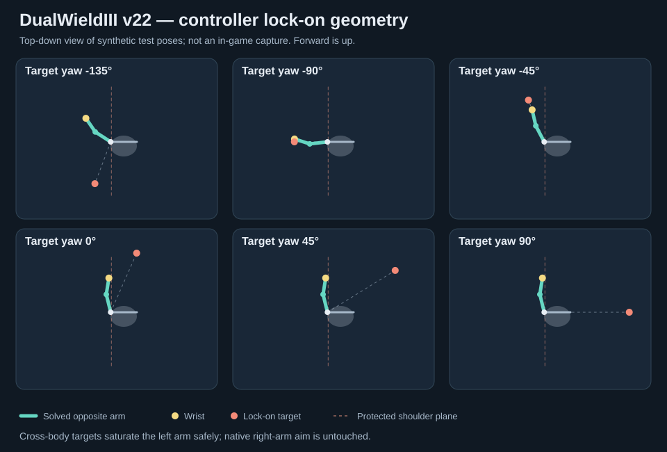

# DualWield.III

Dual-wield backport for classic **Grand Theft Auto III 1.0 EN**.

Supports Colt .45 and Uzi with a second visible weapon, dual firing and native muzzle effects. The second weapon is a standalone `RpAtomic` outside the player ped clump. Supports the stock PC `RwFrame` skeleton and the Skin & Bones/Xbox HAnim skeleton with guarded compatibility hooks.

## v24: native aim ray and separate upper/forearm control

The reported v23 screenshot showed the second arm raised and pointing away from the reticle. The previous solve mistakenly treated the weapon muzzle-position offset as a direction and prohibited all inboard wrist movement, even in front of the chest.

- The free-aim cue now follows III's actual third-person mouse camera shot ray, or the native hand's local +X aim axis on the other aiming paths. Controller lock-on uses the registered target, with near-target blending. Native right-arm animation, native IK and native firing remain untouched.
- The second forearm follows the aim ray; upper-arm yaw is controlled independently to keep the elbow close to the body. Inboard motion is permitted **in front of** the chest. The two actual bone lengths and elevation are preserved, with a finite torso-depth exclusion region rather than an infinite shoulder-side plane.
- A copied stock grip follows the solved direction without editing the right hand. Stock and HAnim render paths both use a temporary, checked left-arm pose, draw the weapon from that pose and then restore the previous local state. Native shot handling is preserved.
- Rate-limited diagnostics record actual joint positions, both gun axes, aim source, solved/actual forearm directions and post-draw residuals. If a chained renderer changes the pose, the log gives evidence of that as well.

Extremely sideways/rearward directions and near-body targets still have safety limits. This correction is grounded in the engine's aiming implementation, but it has **not** been visually verified in GTA III itself.



## Install / build

Download the `DualWieldIII-Win32` artifact from the successful GitHub Actions run. Extract its zip and place `DualWieldIII.asi` and `DualWieldIII.ini` together where your GTA III ASI loader loads plugins. No FusionFix dependency. Skin & Bones is optional. Use GTA III 1.0 EN; other executables are not supported by these fixed hook addresses.

The project is Win32 Release, Visual Studio 2022 (v143). The workflow checks out Plugin-SDK at the October 25, 2025 commit [624a6a49265fd7a6fc63bda1611013ceabeacb8a](https://github.com/DK22Pac/plugin-sdk/commit/624a6a49265fd7a6fc63bda1611013ceabeacb8a), generates its Visual Studio project, builds `plugin_iii`, runs the IK tests on x86 and Linux, builds the ASI, checks its PE machine type, and packages the ASI, INI and README.

To build locally, set `PLUGIN_SDK_DIR` to that checkout (including submodules), generate/build the SDK as in `.github/workflows/build.yml`, then:

```bat
msbuild DualWieldIII.vcxproj /m /p:Configuration="Release GTA3" /p:Platform=Win32
```

## Configuration

The mod reads `DualWieldIII.ini` next to the ASI. All keys are optional and have compiled defaults; the supplied INI documents those defaults. It does not write an INI automatically.

| Key | Default | Meaning |
|---|---:|---|
| LeftArmIK | 1 | Enable constrained second-arm posing |
| AimBlendFrames | 1 | Frames to ramp in aim |
| AimHoldFrames | 4 | Short aim-continuity hold |
| ArmReachScale | 0.980 | Preferred maximum extension fraction (0.70–1.00); aim and collision safety take precedence |
| ElbowOutwardDeg | 0 | Optional extra bounded elbow flare (0–15) |
| HandAimLimitDeg | 90 | Max forward wrist correction per solve |
| HandRollLimitDeg | 60 | Max barrel-axis wrist roll per solve |
| CopyNativeGripBasis | 1 | Stable native-basis stock socket / bind-relative skinned socket |
| LateProcessRepair | 0 | Optional compatibility repair for stock frame mods |
| LogIKDiagnostics | 1 | Log actual aimed render poses, at most once per 90 frames |

## Verification

```sh
g++ -std=c++17 -O2 -Wall -Wextra -Werror tests/test_ik.cpp -o test_ik
./test_ik
```

Headless tests exercise 290,672 poses, covering cross-body aim toward the actual camera ray, sideways-punch regression, close targets, vertical pitch, all yaw quadrants, asymmetric arm lengths, old reach settings, partial blend, rigid transforms, degeneracy and rebuilt-joint validation. The tests do not establish in-game visual quality or compatibility with arbitrary renderer/skeleton mods.

If the left arm still looks wrong, capture `DualWieldIII.log` beside the ASI after aiming for a few seconds; `IK24` lines distinguish the camera/lock/hand aim source, actual joint positions and weapon axes, and before/after-render discrepancies. See [handoff notes](new%20chat/HANDOFF.md) for the gameplay checklist.

## TODO

- Gameplay integration (stats system or cheat to activate).
- In-game visual regression testing and compatibility with additional skeleton replacements.
